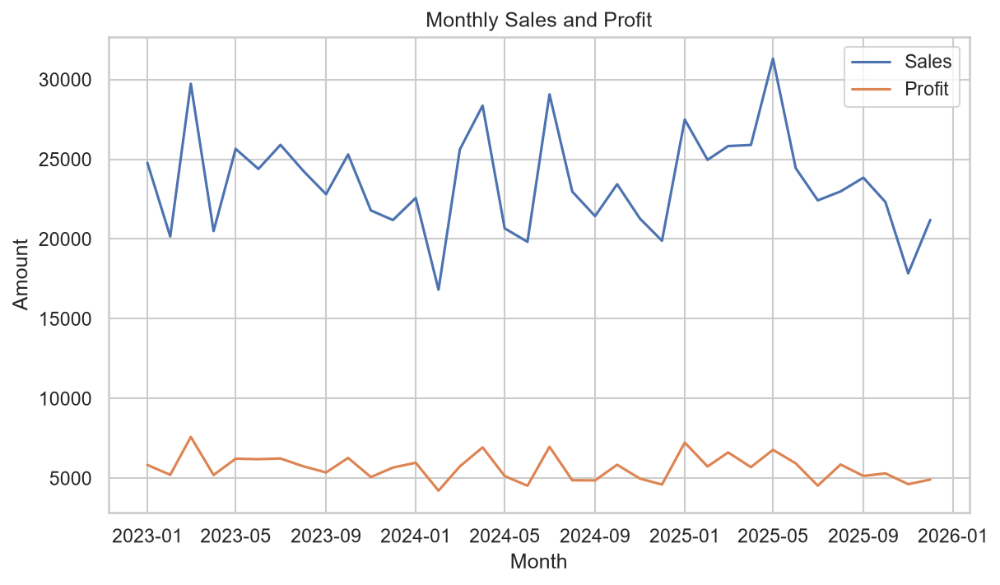
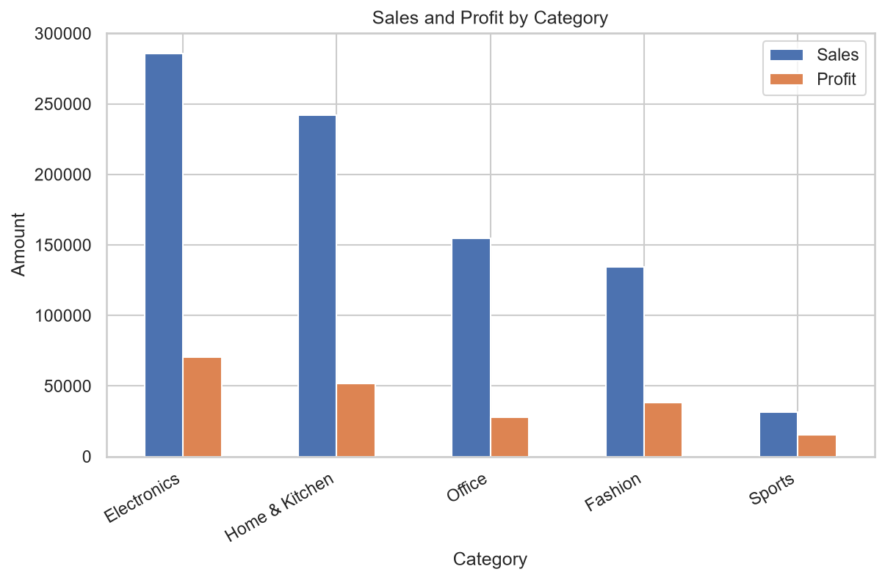
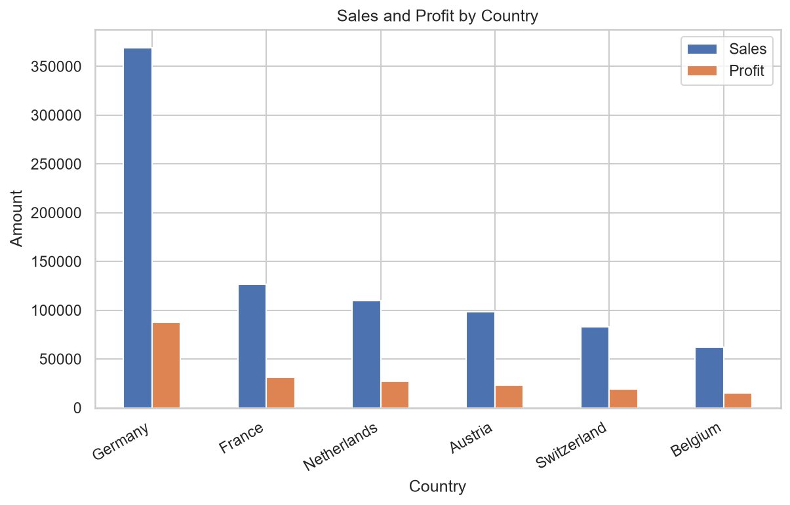

# E-commerce Orders Analysis

End-to-end analysis of an e-commerce orders dataset: data understanding, data cleaning, exploratory data analysis (EDA), visualization and business insights, using Python and pandas.

> **Status:** 🚧 In progress. Steps 1 (Data Understanding) and 2 (Data Cleaning) are complete. Currently working on Step 3 (EDA and Visualization).

---

## Table of Contents

1. [Project Goal](#project-goal)
2. [Dataset](#dataset)
3. [Disclaimer](#disclaimer)
4. [Workflow](#workflow)
5. [Data Understanding Summary](#data-understanding-summary)
6. [Business Questions](#business-questions)
7. [Data Cleaning Summary](#data-cleaning-summary)
8. [Analysis Rules](#analysis-rules)
9. [Key Findings](#key-findings)
10. [Project Structure](#project-structure)
11. [How to Run](#how-to-run)
12. [Tools](#tools)
13. [Author](#author)

---

## Project Goal

Understand sales, profit, discounts, delivery performance and returns of an online store, and answer practical business questions with data. The project is also a learning exercise that covers the full workflow of a small data analysis project: from a messy raw file to a clean dataset, visual exploration and written recommendations.

## Dataset

| Item | Details |
|------|---------|
| Raw file | `data/raw/ecommerce_orders_raw.csv` (5,020 rows × 28 columns) |
| Clean file | `data/processed/ecommerce_orders_clean.csv` (5,000 rows × 31 columns) |
| Period covered | 2023-01-01 to 2025-12-31 |
| Granularity | One row per order line |
| Source | Synthetic dataset generated with ChatGPT (OpenAI) for learning purposes |

The columns cover orders, customers, products, pricing and discounts, sales, cost and profit, payment, shipping and delivery, customer rating, returns, marketing channel and device type. A full column-by-column description is in [`data/data_dictionary.md`](data/data_dictionary.md).

The raw file is kept untouched. The cleaned version is saved separately in `data/processed/`. The clean file has 3 added columns: `Year`, `Month` and `Total_Cost` (`Quantity × Cost`).

## Disclaimer

All data in this project is **synthetic**. It does not represent a real company or real customers. Findings describe patterns in this generated dataset only and should not be treated as real-world business insights.

## Workflow

| Step | Notebook | Purpose | Status |
|------|----------|---------|--------|
| 1 | `notebooks/01_data_understanding.ipynb` | Inspect structure, types, missing values, duplicates and value ranges | ✅ Done |
| 2 | `notebooks/02_data_cleaning.ipynb` | Fix inconsistencies and produce a clean dataset | ✅ Done |
| 3 | `notebooks/03_eda_visualization.ipynb` | Explore distributions, trends and relationships with charts | 🔄 In progress |
| 4 | `notebooks/04_business_questions.ipynb` | Answer specific business questions and give recommendations | ⏳ Not started |

Every cleaning decision (what was wrong, how many rows, what was done and why) is documented in [`docs/cleaning_decisions.md`](docs/cleaning_decisions.md).

## Data Understanding Summary

Main findings from Step 1 (details in `notebooks/01_data_understanding.ipynb`):

- **Dates:** `Order_Date` is stored as text in 3 different formats (`YYYY-MM-DD`, `DD/MM/YYYY`, `Mon DD, YYYY`).
- **Inconsistent spellings:** `Gender` has 12 spellings for 2 values, `Country` has 23 labels for 6 countries and `Category` has 17 labels for 5 categories. Many values also have extra leading or trailing spaces.
- **Missing values:** 10 columns have missing values (2.4% to 5.6% each). About 29% of rows have at least one missing value, so deleting them all is not an option.
- **Duplicates:** 20 exact duplicate rows.
- **Impossible values:** negative or extreme ages, zero or negative quantities, discounts outside 0–1, ratings outside 1–5 and negative delivery days.
- **Logical inconsistencies:** cancelled orders still have ratings and delivery days, and `Returned` is an exact copy of `Order_Status = Returned`.
- **Customer data:** the same `Customer_ID` appears with different names, ages and genders, so customer-level analysis (for example repeat customers) is not reliable.
- **Verified relationships:** `Sales = Quantity × Unit_Price × (1 − Discount)` and `Profit = Sales − Quantity × Cost`, so `Cost` is a cost per unit.

## Business Questions

_Draft list. It will be finalized after the exploratory analysis._

1. How do sales and profit change over time (month, quarter, year)?
2. Which product categories and products bring the most revenue, and which bring the most profit?
3. How do discounts affect quantity sold and profit? At what discount level do orders start losing money?
4. Which marketing channels, customer segments and countries perform best?
5. How do shipping method and delivery time relate to customer rating and returns?

Questions about individual customers (such as repeat buying) are left out on purpose because of the customer data problem described above.

## Data Cleaning Summary

Raw file: 5,020 rows × 28 columns. Clean file: 5,000 rows × 31 columns. Full details and reasons are in [`docs/cleaning_decisions.md`](docs/cleaning_decisions.md).

| Issue | Rows affected | Action |
|-------|---------------|--------|
| Extra spaces in text columns | Gender 820, Country 458, Customer_Name 8 | Removed with `str.strip()` |
| `Order_Date` as text in 3 formats | All rows | Parsed each format with an explicit format string; 0 failures |
| Inconsistent spellings | Gender 12, Country 23, Category 17 labels | Mapped to 2 genders, 6 countries, 5 categories |
| Exact duplicate rows | 20 | Removed (`Order_ID` is now unique) |
| Impossible values | Age 4, Discount 2, Customer_Rating 2, Delivery_Days 1 | Set to missing |
| Quantity <= 0 | 3 | Recovered with `(Sales − Profit) / Cost` |
| Missing `Discount` | 199 | Recovered with `1 − Sales / (Quantity × Unit_Price)` |
| Missing `City` | 128 | 70 filled from `Region`, 58 set to "Unknown" |
| Missing Gender, Segment, Payment, Channel, Name | 174 / 128 / 135 / 130 / 121 | Filled with "Unknown" |
| Cancelled orders with rating and delivery days | See `cleaning_decisions.md` | Set to missing (a cancelled order has no delivery or rating) |
| `Customer_ID` inconsistent with name, age, gender | Most IDs | Not changed; documented as a limitation |

Missing values kept on purpose (not filled with averages): `Age` (171), `Delivery_Days` (449) and `Customer_Rating` (522).

## Analysis Rules

- **Cancelled orders are excluded** from sales and profit totals, because they did not generate revenue.
- **Returned orders are kept** in the totals, because the data does not say whether the money was refunded. Returns are analysed separately in Step 4.
- Missing `Age`, `Delivery_Days` and `Customer_Rating` are ignored by averages and charts.

## Key Findings

_Preliminary results from Step 3 (cancelled orders excluded). The final findings will be added after Step 4. All results describe this synthetic dataset only._

### Sales over time

Monthly sales move between about 17,000 (February 2024: 16,821) and 31,000 (May 2025: 31,306) with no clear upward or downward trend. Profit is much steadier and follows the same direction.



### Category

Electronics and Home & Kitchen bring 62.2% of total sales (848,957). Sports is the smallest category (3.7% of sales) but has the highest profit margin (47.8%). Office has the lowest margin (18.1%).



### Country

Germany brings 43.5% of total sales, almost three times France. Profit margins are similar across all six countries (22.9% to 24.9%), so the difference is in sales volume, not in margin.



## Project Structure

```text
Ecommerce_Orders_Analysis/
├── data/
│   ├── raw/                      # original data (never edited)
│   ├── processed/                # cleaned data
│   └── data_dictionary.md        # column descriptions
├── docs/
│   └── cleaning_decisions.md     # cleaning decisions and reasons
├── notebooks/
│   ├── 01_data_understanding.ipynb
│   ├── 02_data_cleaning.ipynb
│   ├── 03_eda_visualization.ipynb
│   └── 04_business_questions.ipynb
├── reports/
│   ├── figures/                  # saved charts
│   └── summary.md                # summary of results and recommendations
├── src/
│   └── cleaning.py               # reusable cleaning functions
├── .gitignore
├── LICENSE
├── README.md
└── requirements.txt
```

## How to Run

```bash
git clone https://github.com/ariful3551/Ecommerce-Orders-Analysis.git
cd Ecommerce-Orders-Analysis

python -m venv .venv
.venv\Scripts\activate          # Windows
# source .venv/bin/activate     # macOS / Linux

pip install -r requirements.txt
jupyter notebook
```

Run the notebooks in order, from `01` to `04`. Notebook `02` creates `data/processed/ecommerce_orders_clean.csv`, which notebooks `03` and `04` read with `parse_dates=["Order_Date"]`.

## Tools

Python, pandas, NumPy, Matplotlib, Seaborn, Jupyter Notebook, Git and GitHub.

## Author

**Ariful Islam**
GitHub: [@ariful3551](https://github.com/ariful3551)