# E-commerce Orders Analysis

End-to-end analysis of an e-commerce orders dataset: data understanding, data cleaning, exploratory data analysis (EDA), visualization and business insights, using Python and pandas.

> **Status:** ✅ Complete. All four steps are finished. The full written summary is in [`reports/summary.md`](reports/summary.md).

---

## Table of Contents

1. [Project Goal](#project-goal)
2. [Dataset](#dataset)
3. [Disclaimer](#disclaimer)
4. [Workflow](#workflow)
5. [Data Understanding Summary](#data-understanding-summary)
6. [Data Cleaning Summary](#data-cleaning-summary)
7. [Analysis Rules](#analysis-rules)
8. [Business Questions and Answers](#business-questions-and-answers)
9. [Key Findings](#key-findings)
10. [Recommendations](#recommendations)
11. [Limitations](#limitations)
12. [Project Structure](#project-structure)
13. [How to Run](#how-to-run)
14. [Tools](#tools)
15. [AI Assistance](#ai-assistance)
16. [Author](#author)

---

## Project Goal

Understand sales, profit, discounts, delivery performance and returns of an online store, and answer practical business questions with data. The project is also a learning exercise that covers the full workflow of a small data analysis project: from a messy raw file to a clean dataset, visual exploration and written recommendations.

## Dataset

| Item | Details |
|------|---------|
| Raw file | `data/raw/ecommerce_orders_raw.csv` (5,020 rows × 28 columns) |
| Clean file | `data/processed/ecommerce_orders_clean.csv` (5,000 rows × 31 columns) |
| Period covered | 2023-01-01 to 2025-12-31 |
| Granularity | One row per order line |
| Source | Synthetic dataset generated with ChatGPT (OpenAI) for learning purposes |

The columns cover orders, customers, products, pricing and discounts, sales, cost and profit, payment, shipping and delivery, customer rating, returns, marketing channel and device type. A full column-by-column description is in [`data/data_dictionary.md`](data/data_dictionary.md).

The raw file is kept untouched. The cleaned version is saved separately in `data/processed/`. The clean file has 3 added columns: `Year`, `Month` and `Total_Cost` (`Quantity × Cost`).

## Disclaimer

All data in this project is **synthetic**. It does not represent a real company or real customers. Findings describe patterns in this generated dataset only and should not be treated as real-world business insights.

## Workflow

| Step | Notebook | Purpose | Status |
|------|----------|---------|--------|
| 1 | `notebooks/01_data_understanding.ipynb` | Inspect structure, types, missing values, duplicates and value ranges | ✅ Done |
| 2 | `notebooks/02_data_cleaning.ipynb` | Fix inconsistencies and produce a clean dataset | ✅ Done |
| 3 | `notebooks/03_eda_visualization.ipynb` | Explore distributions, trends and relationships with charts | ✅ Done |
| 4 | `notebooks/04_business_questions.ipynb` | Answer specific business questions and give recommendations | ✅ Done |

Every cleaning decision (what was wrong, how many rows, what was done and why) is documented in [`docs/cleaning_decisions.md`](docs/cleaning_decisions.md).

## Data Understanding Summary

Main findings from Step 1 (details in `notebooks/01_data_understanding.ipynb`):

- **Dates:** `Order_Date` is stored as text in 3 different formats (`YYYY-MM-DD`, `DD/MM/YYYY`, `Mon DD, YYYY`).
- **Inconsistent spellings:** `Gender` has 12 spellings for 2 values, `Country` has 23 labels for 6 countries and `Category` has 17 labels for 5 categories. Many values also have extra leading or trailing spaces.
- **Missing values:** 10 columns have missing values (2.4% to 5.6% each). About 29% of rows have at least one missing value, so deleting them all is not an option.
- **Duplicates:** 20 exact duplicate rows.
- **Impossible values:** negative or extreme ages, zero or negative quantities, discounts outside 0–1, ratings outside 1–5 and negative delivery days.
- **Logical inconsistencies:** cancelled orders still have ratings and delivery days, and `Returned` is an exact copy of `Order_Status = Returned`.
- **Customer data:** the same `Customer_ID` appears with different names, ages and genders, so customer-level analysis (for example repeat customers) is not reliable.
- **Verified relationships:** `Sales = Quantity × Unit_Price × (1 − Discount)` and `Profit = Sales − Quantity × Cost`, so `Cost` is a cost per unit.

## Data Cleaning Summary

Raw file: 5,020 rows × 28 columns. Clean file: 5,000 rows × 31 columns. Full details and reasons are in [`docs/cleaning_decisions.md`](docs/cleaning_decisions.md).

| Issue | Rows affected | Action |
|-------|---------------|--------|
| Extra spaces in text columns | Gender 820, Country 458, Customer_Name 8 | Removed with `str.strip()` |
| `Order_Date` as text in 3 formats | All rows | Parsed each format with an explicit format string; 0 failures |
| Inconsistent spellings | Gender 12, Country 23, Category 17 labels | Mapped to 2 genders, 6 countries, 5 categories |
| Exact duplicate rows | 20 | Removed (`Order_ID` is now unique) |
| Impossible values | Age 4, Discount 2, Customer_Rating 2, Delivery_Days 1 | Set to missing |
| Quantity <= 0 | 3 | Recovered with `(Sales − Profit) / Cost` |
| Missing `Discount` | 199 | Recovered with `1 − Sales / (Quantity × Unit_Price)` |
| Missing `City` | 128 | 70 filled from `Region`, 58 set to "Unknown" |
| Missing Gender, Segment, Payment, Channel, Name | 174 / 128 / 135 / 130 / 121 | Filled with "Unknown" |
| Cancelled orders with rating and delivery days | 256 cancelled orders (237 with a rating, 247 with delivery days) | Rating and delivery days set to missing |
| `Customer_ID` inconsistent with name, age, gender | Most IDs | Not changed; documented as a limitation |

Missing values kept on purpose (not filled with averages): `Age` (171), `Delivery_Days` (449) and `Customer_Rating` (522).

## Analysis Rules

- **Cancelled orders are excluded** from sales and profit totals, because they did not generate revenue. The analysis uses 4,744 revenue orders.
- **Returned orders are kept** in the totals, because the data does not say whether the money was refunded. Returns are analysed separately.
- Missing `Age`, `Delivery_Days` and `Customer_Rating` are ignored by averages and charts.
- Profit margin = profit ÷ sales.

## Business Questions and Answers

| # | Question | Short answer |
|---|----------|--------------|
| 1 | How do sales and profit change over time? | Sales fell 5.1% in 2024 and rose 6.8% in 2025 (only 1.4% above 2023). The profit margin slipped every year (24.6%, 23.8%, 23.5%). Quarter 4 is the weakest quarter in each year. |
| 2 | Which categories and products bring the most revenue and profit? | Electronics and Home & Kitchen bring 62.2% of sales. Robot Vacuum is the top product (15.3% of sales). The five biggest products bring 55.5% of sales. Office Chair and Robot Vacuum have the lowest margins (10.9%, 15.2%). |
| 3 | How do discounts affect quantity and profit? | Quantity per order stays at about 1.9, but the margin falls from 36.5% (0-5% discount) to 5.8% (30-35%). Losses start at about an 18.5% discount and are common above 30% (134 of 155 loss-making orders). |
| 4 | Which channels, segments and countries perform best? | Germany brings 43.5% of sales and Consumer 56.4%, because of the number of orders. The six marketing channels are balanced (15.7% to 16.8% each). Margins are similar inside each group. |
| 5 | How do shipping and delivery time relate to rating and returns? | No clear relation. Ratings are 3.96 to 3.99 for every shipping method; the correlation of delivery days and rating is -0.04. The return rate is 7.3% and spread evenly. |

## Key Findings

_Cancelled orders excluded: 4,744 orders, total sales 848,957, total profit 203,627. All results describe this synthetic dataset only._

### Sales over time

Monthly sales move between 16,821 (February 2024) and 31,306 (May 2025) with no clear upward or downward trend. Profit is steadier and follows the same direction.

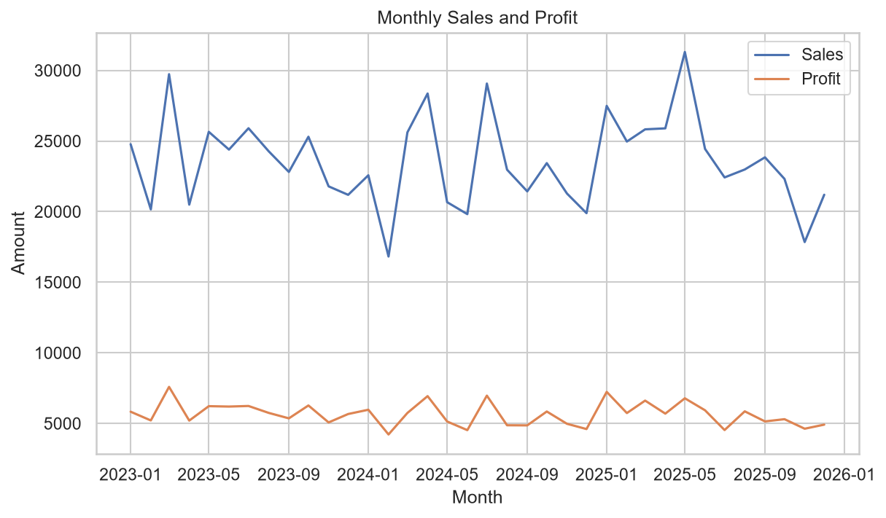

### Category

Electronics and Home & Kitchen bring 62.2% of total sales. Sports is the smallest category (3.7% of sales) but has the highest profit margin (47.8%). Office has the lowest margin (18.1%).

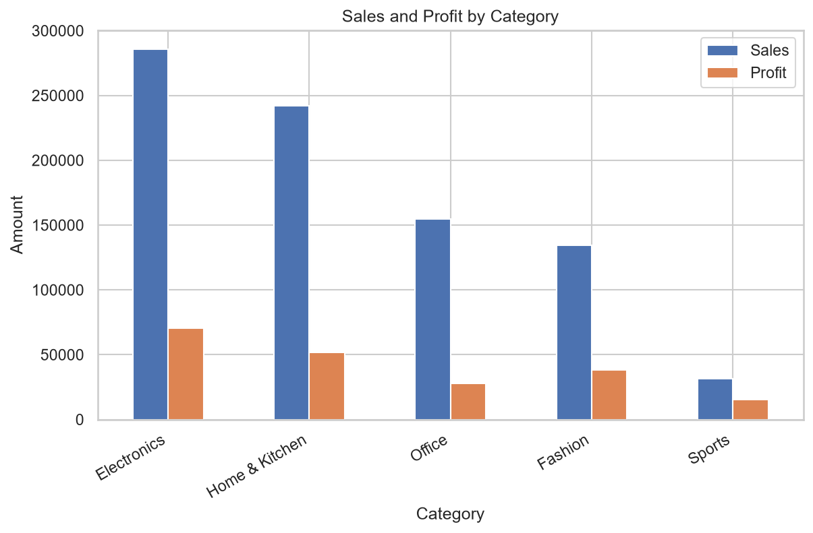

### Country

Germany brings 43.5% of total sales because it has the most orders (2,076 of 4,744), not because its orders are bigger. Profit margins are similar across all six countries (22.9% to 24.9%).

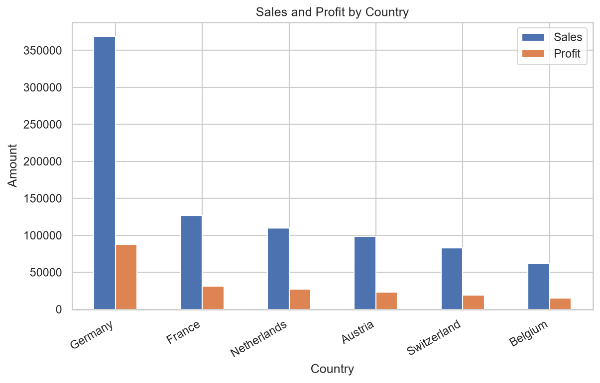

### Discounts

Deeper discounts do not bring bigger orders (average quantity stays at about 1.9), but the profit margin falls from 36.5% (0-5% discount) to 5.8% (30-35%). 155 orders lost money, and 134 of them have a discount above 30%.

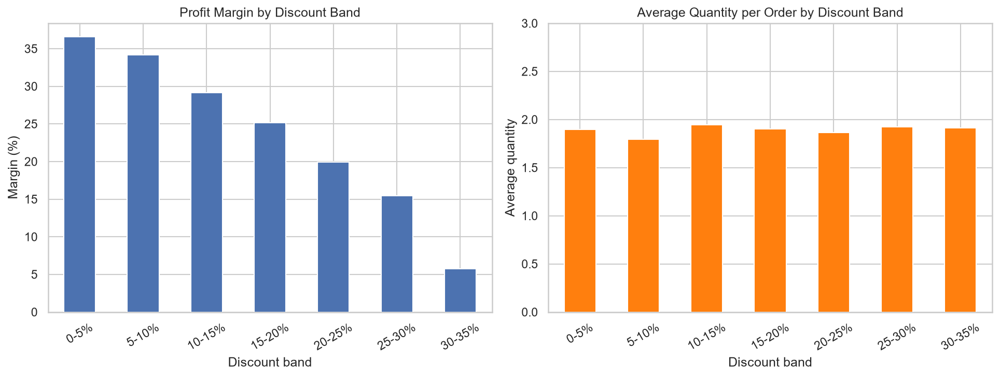

### Delivery, ratings and returns

Shipping method changes delivery time (Pickup 1.0 day, Express 2.5, Standard 6.0) but not the average rating (3.96 to 3.99). Delivery time has almost no relation with rating or returns. The return rate is 7.3% and is spread evenly.

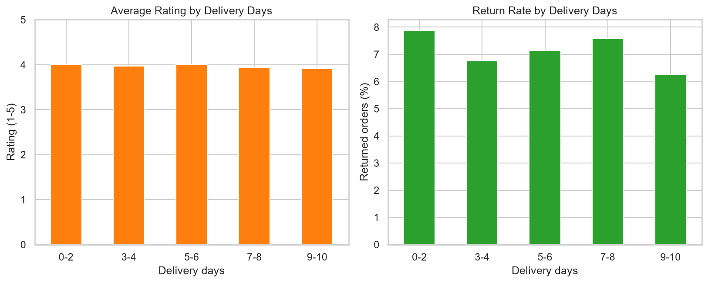

### Other results

- **Marketing channel:** the six known channels are balanced (15.7% to 16.8% of sales each).
- **Customer segment:** Consumer brings 56.4% of sales; margins are similar in all segments.
- **Device:** Desktop (46.5%) and Mobile (46.1%) are almost equal; Tablet is 7.4%.

<details>
<summary>More charts</summary>

#### Marketing channel
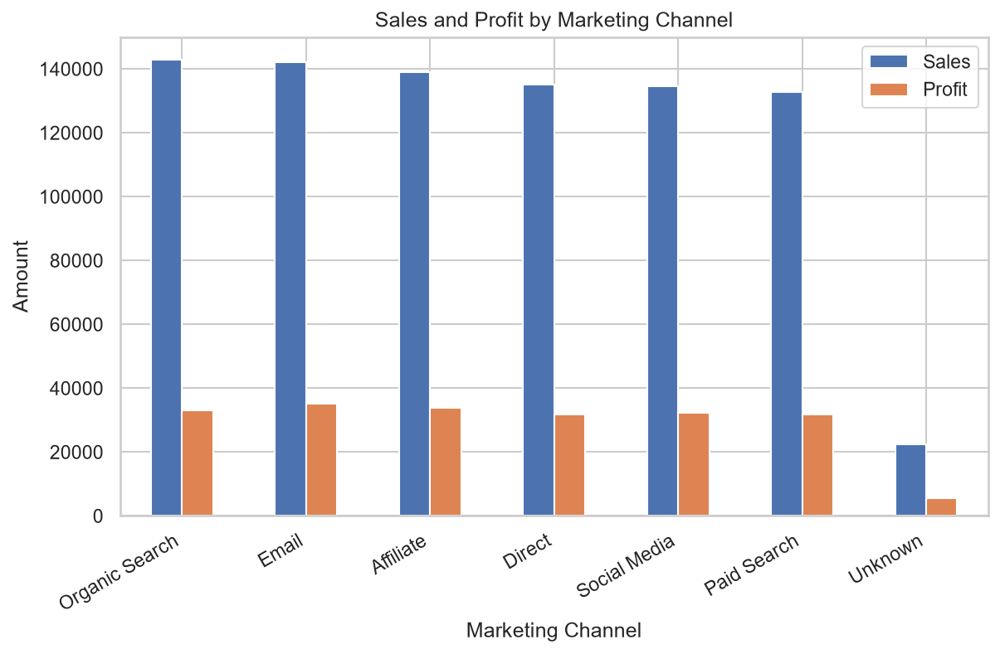

#### Customer segment
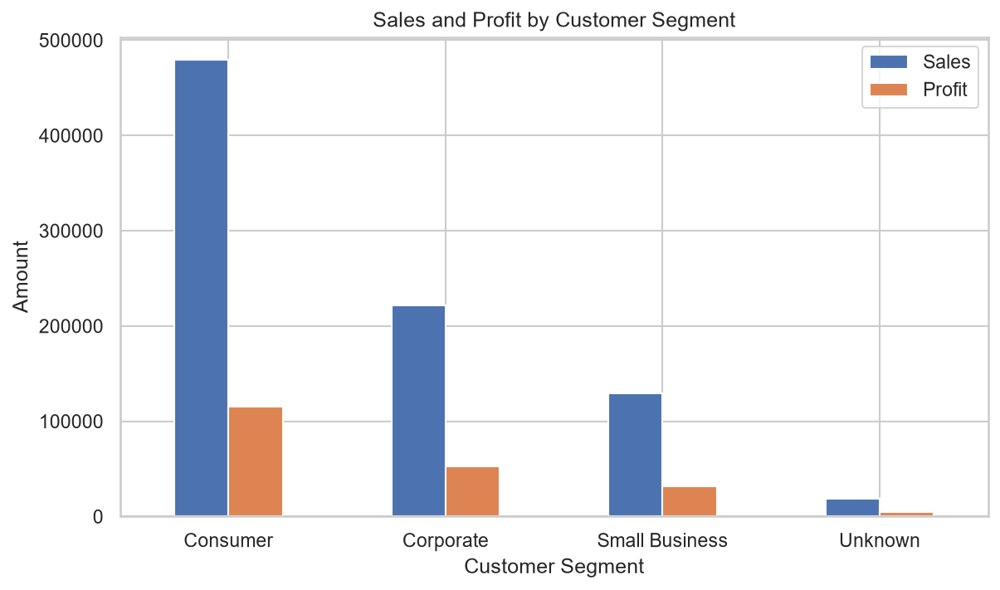

#### Device type
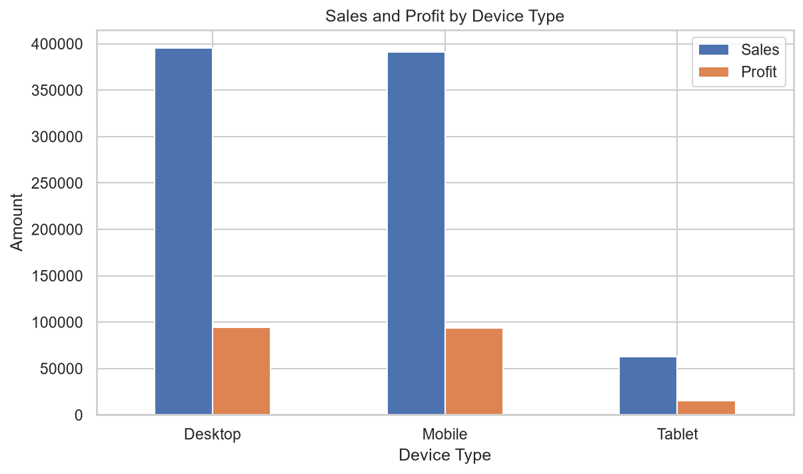

#### Discount distribution
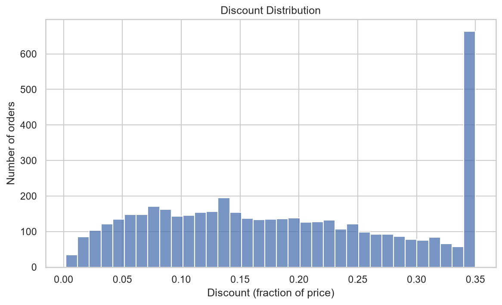

#### Shipping method
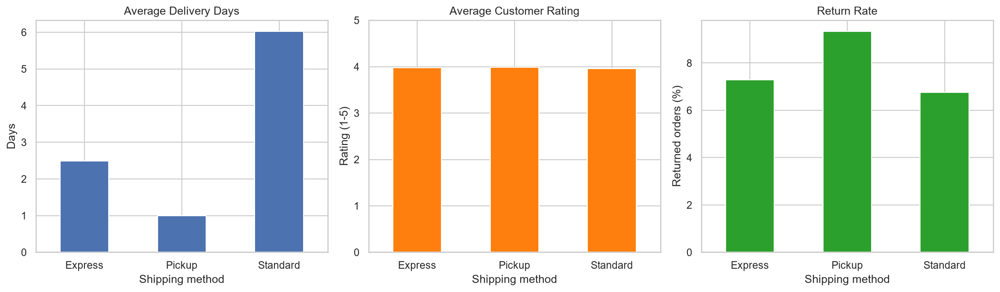

#### Quarterly sales by year
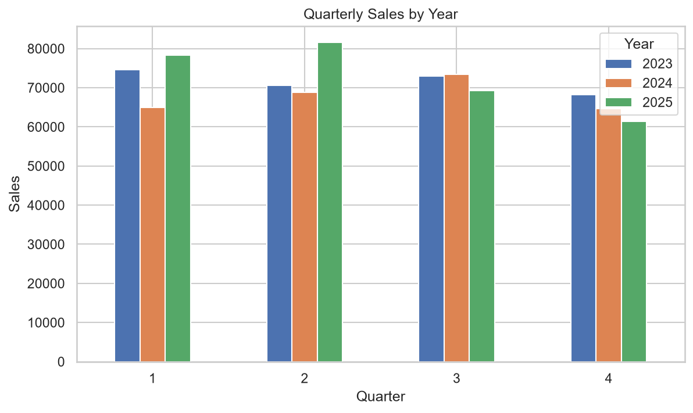

#### Sales and profit by product
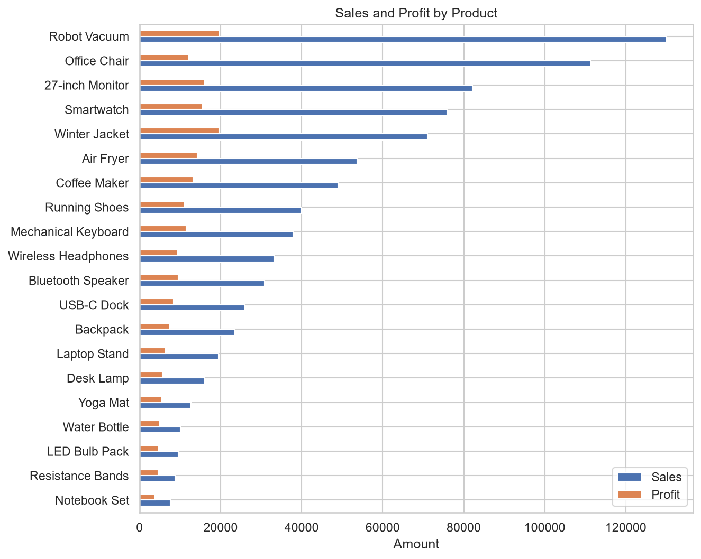

#### Discount margin and losses
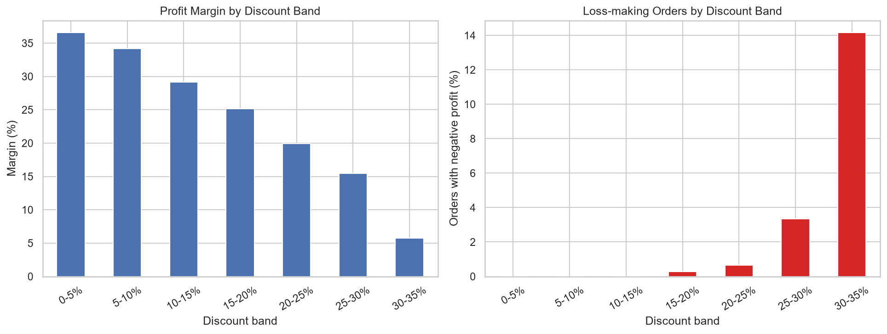

</details>

All charts are in [`reports/figures/`](reports/figures/).

## Recommendations

1. **Review discounts above 30%.** They give a 5.8% margin, 86.5% of all loss-making orders and no larger orders. Test a lower maximum (for example 25%) and compare orders and margin.
2. **Review the price or cost of Office Chair and Robot Vacuum.** Together they bring 28.4% of sales at margins of 10.9% and 15.2%.
3. **Track margin, not only sales.** Sales recovered in 2025, but the margin fell three years in a row.
4. **Do not pay for faster shipping to raise ratings**, because speed does not change the rating in this data. Collect a return reason to find out why orders are returned.
5. **Reduce the dependence on Germany** (43.5% of sales) and consider growing other countries, for example the Netherlands, which has the highest average order (196.3).
6. **Do not move marketing budget between channels based on this data.** The channels are almost equal and no channel cost is available.

The full write-up is in [`reports/summary.md`](reports/summary.md).

## Limitations

- The data is synthetic and covers three years.
- `Customer_ID` is not consistent with name, age and gender, so the analysis counts orders, not unique customers.
- `Age`, `Delivery_Days` and `Customer_Rating` have missing values that were kept as missing.
- There is no data on marketing cost, shipping cost, return reasons or refunds, so some recommendations are ideas to test, not conclusions.

## Project Structure

```text
Ecommerce_Orders_Analysis/
├── data/
│   ├── raw/                      # original data (never edited)
│   ├── processed/                # cleaned data
│   └── data_dictionary.md        # column descriptions
├── docs/
│   └── cleaning_decisions.md     # cleaning decisions and reasons
├── notebooks/
│   ├── 01_data_understanding.ipynb
│   ├── 02_data_cleaning.ipynb
│   ├── 03_eda_visualization.ipynb
│   └── 04_business_questions.ipynb
├── reports/
│   ├── figures/                  # saved charts
│   └── summary.md                # summary of results and recommendations
├── src/
│   └── cleaning.py               # reusable cleaning functions
├── .gitignore
├── LICENSE
├── README.md
└── requirements.txt
```

## How to Run

```bash
git clone https://github.com/ariful3551/Ecommerce-Orders-Analysis.git
cd Ecommerce-Orders-Analysis

python -m venv .venv
.venv\Scripts\activate          # Windows
# source .venv/bin/activate     # macOS / Linux

pip install -r requirements.txt
jupyter notebook
```

Run the notebooks in order, from `01` to `04`. Notebook `02` creates `data/processed/ecommerce_orders_clean.csv`, which notebooks `03` and `04` read with `parse_dates=["Order_Date"]`.

## Tools

Python, pandas, NumPy, Matplotlib, Seaborn, Jupyter Notebook, Git and GitHub.

## AI Assistance

This project was developed as a learning exercise with the assistance of AI tools.

- **ChatGPT (OpenAI):** Used to generate the dataset.
- **Claude (Anthropic):** Used as a guide for planning the workflow, suggesting code improvements, and reviewing written explanations.

All code was executed by me in my own development environment. I independently checked the outputs against the notebook results and documented the data-cleaning decisions and analytical conclusions in `docs/cleaning_decisions.md` and `reports/summary.md`.

I take responsibility for understanding, executing, validating, and documenting the entire analysis rather than relying blindly on AI-generated suggestions. AI tools supported my learning process, but the implementation, verification, and final decisions were my responsibility.

## License

This project is licensed under the MIT License. See the [LICENSE](LICENSE) file for details.

## Author

**Ariful Islam**
GitHub: [@ariful3551](https://github.com/ariful3551)

Email: ariful3551@gmail.com